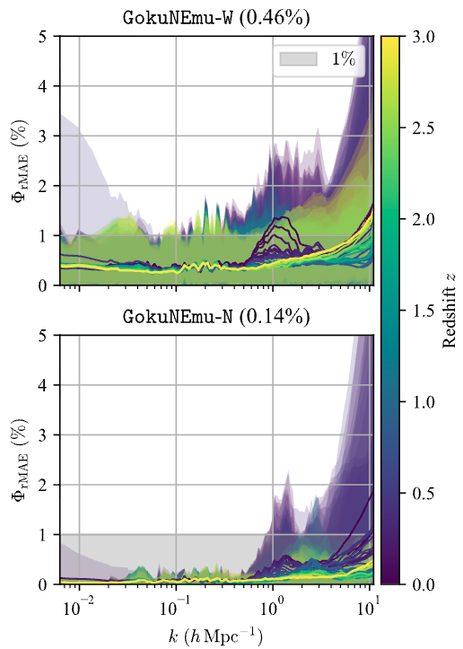

# GokuNEmu: A Neural Network Emulator Based on the Goku Simulation Suite

**GokuNEmu** is a neural network (NN) emulator for the nonlinear matter power spectrum, trained on simulations from the **Goku** suite using the [T2N-MusE](https://github.com/astro-YYH/T2N-MusE) emulation technique.

The nonlinear matter power spectrum describes how matter clusters across cosmic scales and is a key link between cosmological models and observations of large-scale structure and gravitational lensing. GokuNEmu provides fast predictions across a broad cosmological parameter space—including models with dynamical dark energy and massive neutrinos—so users can explore and constrain cosmology without running a new, computationally expensive $N$-body simulation for every parameter choice. **GokuNEmu is the fastest matter power spectrum emulator, taking approximately 1 millisecond per single-cosmology evaluation**; see the [speed benchmark](examples/speed_benchmark.ipynb).

> **Post-publication update:** The current package no longer uses the models trained on the full combined data set. It now builds both **GokuNEmu-N** and **GokuNEmu-W** internally from the corresponding `N_L*` and `W_L*` models. Inputs within the Goku-N parameter box are evaluated with GokuNEmu-N; all other inputs are evaluated with GokuNEmu-W. The L1-L2 transition uses sigmoid sharpness 6 for GokuNEmu-N and 4 for GokuNEmu-W. The new models were trained using updated, more robust T2N-MusE methods introduced before [commit `49acdc1`](https://github.com/astro-YYH/T2N-MusE/commit/49acdc1514e838bc41e6bed48856a4a7e2371155). The training data were also updated: the power spectra were regenerated with `pmesh` on higher-resolution grids, improving their accuracy at the smallest scales (highest $k$) by reducing aliasing effects. In addition, inference was accelerated to approximately 1 millisecond per single-cosmology evaluation. This routing is automatic and does not change the user interface described below.

### Updated leave-one-out validation



*Leave-one-out cross-validation fractional mean absolute errors for the updated GokuNEmu-W and GokuNEmu-N models, shown across scale and redshift in the same format as the paper. The gray band marks the 1% error region.*

## Cosmological parameter space

GokuNEmu takes ten cosmological parameters. The bounds of the broad **Goku-W** parameter space are:

- Total matter density, $\Omega_m$ (`Om`): $[0.22, 0.40]$
- Baryon density, $\Omega_b$ (`Ob`): $[0.040, 0.055]$
- Reduced Hubble parameter, $h$ (`hubble`): $[0.60, 0.76]$
- Primordial scalar amplitude, $A_s$ (`As`): $[1.0 \times 10^{-9}, 3.0 \times 10^{-9}]$
- Scalar spectral index, $n_s$ (`ns`): $[0.80, 1.10]$
- Dark-energy equation-of-state parameter, $w_0$ (`w0`): $[-1.30, 0.25]$
- Dark-energy evolution parameter, $w_a$ (`wa`): $[-3.0, 0.5]$
- Sum of neutrino masses, $\sum m_\nu$ (`mnu`): $[0.0, 0.6]\,\mathrm{eV}$
- Effective number of relativistic species, $N_\mathrm{eff}$ (`Neff`): $[2.2, 4.5]$
- Running of the scalar spectral index, $\alpha_s$ (`alphas`): $[-0.05, 0.05]$

---

## Installation

We recommend installing GokuNEmu via `pip`:

```bash
pip install gokunemu
```

> **Note for Intel Mac users:**  
> PyTorch 2.2 was the final release with macOS x86_64 binaries. Use Python 3.10 or 3.11 and install an Intel-compatible PyTorch stack before GokuNEmu:
> ```bash
> python -m pip install "numpy<2" "torch==2.2.2"
> python -m pip install gokunemu
> ```

---

## Usage

Example notebooks are provided in the `examples/` directory:

- `example.ipynb`: Demonstrates how to use GokuNEmu for predicting the nonlinear matter power spectrum.
- `speed_benchmark.ipynb`: Benchmarks the runtime performance.

## Training data
The data used as the training set for the emulator are available at https://github.com/astro-YYH/T2N-MusE.

---

## Citation

If you use **GokuNEmu**, please cite:

- The main GokuNEmu paper: https://arxiv.org/abs/2507.07177  
- The Goku simulations (optional): https://arxiv.org/abs/2501.06296  
- The T2N-MusE emulation method (optional): https://arxiv.org/abs/2507.07184

---

## License

This project is licensed under the **MIT License**.
